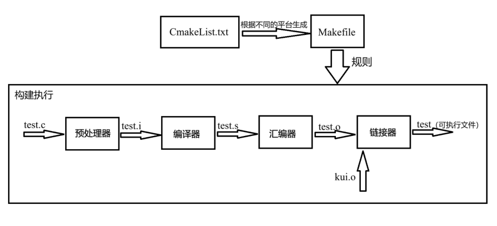
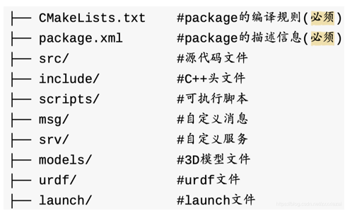

- **编译相关**：
	1. 预处理：展开头文件和宏，删掉注释，处理预处理指令
	2. 编译：进行词法、语法、语义分析代码优化，转换成汇编文件
	3. 汇编：把汇编语言转换成二进制文件
	4. 链接：合并不同的二进制文件成可执行文件
	（下面的看了文档看的不是很懂，简单说一下理解，好多原理看不懂(T^T)）
	5. 虚拟内存：一种储存体系，每个进程都独占内存，但其实不是连续的，通过虚拟内存管理器管理
	6. 静态链接：链接时将静态库直接链接合并到可执行文件里
	7. 动态链接：链接时只提供接口，在运行时将动态库传到内存里，在调用，多个程序可以共用一个库文件

# CMake & Catkin
- **CMake & Catkin概述**：
	- CMake是通用的跨平台构建系统生成器，通过在不同平台生成对应的Makefile管理项目的构建，在不同平台的通用性好
	- Catkin是在CMake上拓展的ROS构建系统
- **CMake构建流程图**：

### CMake基本语法

```CMake
# CMake版本不低于version
cmake_minimum_required(VERSION <version>)

# 定义项目名称和语言(CXX、C)
project(<项目名> <语言>)

# 把源文件编译生成一个可执行文件
add_executable(<可执行文件名> <源文件> ...)

# 变量的使用(${变量名})
# 定义普通变量
set(<变量名> <赋值>...)

# 设置C++版本
set(CMAKE_CXX_STANDARD <版本>)
# 设置可执行文件输出路径
set(EXECUTABLE_OUTPUT_PATH <路径>)
# 设置库文件输出路径
set(LIBRARY_OUTPUT_PATH <路径>)

# 搜索指定路径下的源文件存进变量
aux_source_directory(<dir> <变量>)

# 搜索指定文件并存进变量，文件类型(GLOB_RECURSE递归搜索，GLOB搜索当前目录)
file(GLOB/GLOB_RECURSE <变量名> <文件路径和文件类型>)

# 包含头文件
include_directories(<头文件目录>)

# 包含头文件
target_include_directories(
    <要加载到的文件> 
    <权限> <路径>... 
    [<权限> <路径>...]...) 

# 把源文件生成一个库文件
# STATIC：静态库(.a / .lib)，编译时直接嵌入可执行文件
# SHARED：动态库(.so / .dll)，运行时加载，可以多项目共用
add_library(<项目名> <类型> <源文件> ...)

# 链接静态库，设置全局链接库，这些库会链接到之后定义的所有目标上
link_libraries(<静态库>...)

# 链接库路径，用于查找库
link_directories(<path>)

#链接动态库
# PUBLIC：在public后面的库会被Link到前面的target中，并且里面的符号也会被导出，提供给第三方使用。
# PRIVATE：在private后面的库仅被link到前面的target中，并且终结掉，第三方不能感知你调了什么库
# INTERFACE：在interface后面引入的库不会被链接到前面的target中，只会导出符号
# 应该将命令写到生成了可执行文件之后
target_link_libraries(
    <要加载到的文件> 
    <权限> <库文件>... 
    [<权限> <库文件>...]...)    
```
### List命令操作变量
```CMake
# 字符串拼接
list(APPEND <list> <值>...)
# 删除指定的元素
list(REMOVE_ITEM <list> <值>)
# 获取长度
list(LENGTH <list> <储存输出的变量>)
# 读取列表中指定索引的的元素
list(GET <list> <元素索引>... <储存输出的变量>)
# 连接符（字符串）连接起来组成一个字符串
list (JOIN <list> <连接符> <储存输出的变量>)
# 查找列表是否存在指定的元素，若果未找到，返回-1
list(FIND <list> <值> <储存输出的变量>)
# 插入
list(INSERT <list> <元素索引> <元素>...)
# 删除指定索引的元素
list (REMOVE_AT <list> <索引>...)
# 列表翻转
list(REVERSE <list>)
```
### 常用宏
 
| 宏                        | 功能                                      |
| ------------------------ | --------------------------------------- |
| PROJECT_SOURCE_DIR       | 使用cmake命令后紧跟的目录                         |
| PROJECT_BINARY_DIR       | 执行cmake命令的目录                            |
| CMAKE_CURRENT_SOURCE_DIR | 当前处理的CMakeLists.txt所在的路径                |
| CMAKE_CURRENT_BINARY_DIR | target 编译目录                             |
| EXECUTABLE_OUTPUT_PATH   | 重新定义目标二进制可执行文件的存放位置                     |
| LIBRARY_OUTPUT_PATH      | 重新定义目标链接库文件的存放位置                        |
| PROJECT_NAME             | 返回通过PROJECT指令定义的项目名称                    |
| CMAKE_BINARY_DIR         | 项目实际构建路径，假设在build目录进行的构建，那么得到的就是这个目录的路径 |

### Catkin
 - **工作空间**：

| 空间   | 目录       | 作用                                  |
| ---- | -------- | ----------------------------------- |
| 代码空间 | src/     | 存放所有功能包的源码                          |
| 编译空间 | build/   | 存放 CMake 缓存和编译中间文件                  |
| 开发空间 | devel/   | 存放编译生成的可执行文件，供开发调试使用                |
| 安装空间 | install/ | 执行 `catkin_make install` 后生成，用于最终部署 |


- **package功能包目录结构**：


#### 操作流程
1. **创建工作空间**：
```bash
mkdir -p ~/catkin_ws/src
cd ~/catkin_ws
catkin_make                    # 首次编译，生成 build/ 和 devel/
source devel/setup.bash        # 激活工作空间环境变量
```
2. **创建功能包**：
```Bash
cd ~/catkin_ws/src
catkin_create_pkg beginner_tutorials std_msgs roscpp rospy
```
3. **编译运行**：
```Bash
cd ~/catkin_ws
catkin_make
source devel/setup.bash
rosrun beginner_tutorials <可执行文件名>
```

# 关于AI的使用
### 概念辨析
- **LLM**：
	- 大语言模型，具有大量参数
	- 根据输入字符串推理输出字符串的模型，推理本质是看输出字符串的概率分布，上下文是输入输出的字符串长度限制
- **agent**：
	- 能让LLM能够使用工具、与外部环境交互、并持续执行任务的软件
	- agent软件把工具能力弄成LLM可以阅读和返回的字符串，大模型输出相应字符串调用相应的工具。
	- 相同的模型在不同的agent发挥的性能不同
	- 类比理解：可被人操控的机甲，拥有各种功能。LLM为驾驶员，相同驾驶员在操控不同机甲发挥的能力不同。
- **skill**：
	- 专业知识与技能包，将工作流程与具体领域的知识打包
	- 是解决问题的知识与流程，指导LLM更好的调用工具
	- 可复用的任务指令和配套资源，模块化的专业知识
	- （类似其他人写好的提示词和工具的集合？）
- **AGENTS.md**：
	- 给AI看的项目说明书
	- 用于给AI 提供背景、开发规范和工作指引，规定验证标准
### 使用大模型帮助学习
1. 收集资料：（参考提示词：“去网上搜索关于xx的最佳实践/优秀参考，给出信息来源”）
2. 让ai帮我设计有针对性的课程与学习路线
3. 学习东西时，跟ai说自己的理解，ai纠错
4. AI练习题
### 使用大模型帮助开发
- **提示词框架**：
	1. 清楚说明目标
	2. 提供必要上下文
	3. 明确重要约束
	4. 规定验证标准
	5. 允许AI自主探索
	6. 避免过度规定执行步骤
- 使用skill和AGENTS.md 明确开发规范和约束
- 善用git等工具做好代码版本管理
- 负责任的使用ai，要理解ai写的代码
###  思考
- AI是一个工具，善于使用工具，对于新手的来说，任需要亲手训练理解，这样才能拥有判断对错的基础
- 我认为AI的能力是ai的不是我的，如何将ai的能力转化为我自己的能力是在使用的过程中需要重点思考的
- 在学习过程中使用AI能事半功倍，获取定制化的学习内容，更方便的资料查询
- **之前让ai出的控制原理的题目**：

- 使用ai的经历与反思：之前打电赛，完全使用ai备赛，但是并没有完全理解，导致后续调试的时候出现了许多问题，消耗更多的时间反而事倍功半，合理的使用ai而不是完全依赖它，这次学到教训了
- 最后我对ai的看法：不使用ai是不可能的，使用ai要对团队负责对自己负责。